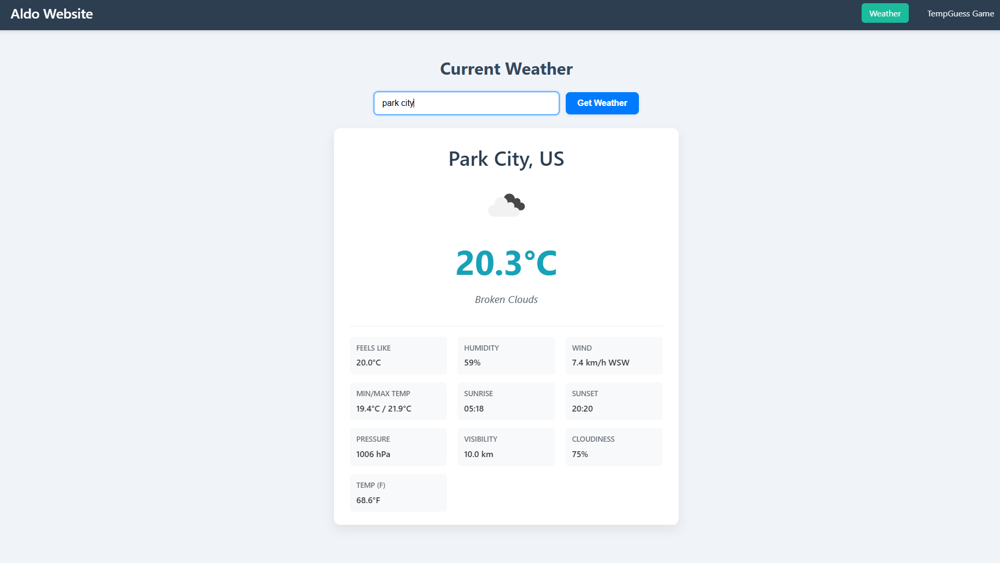
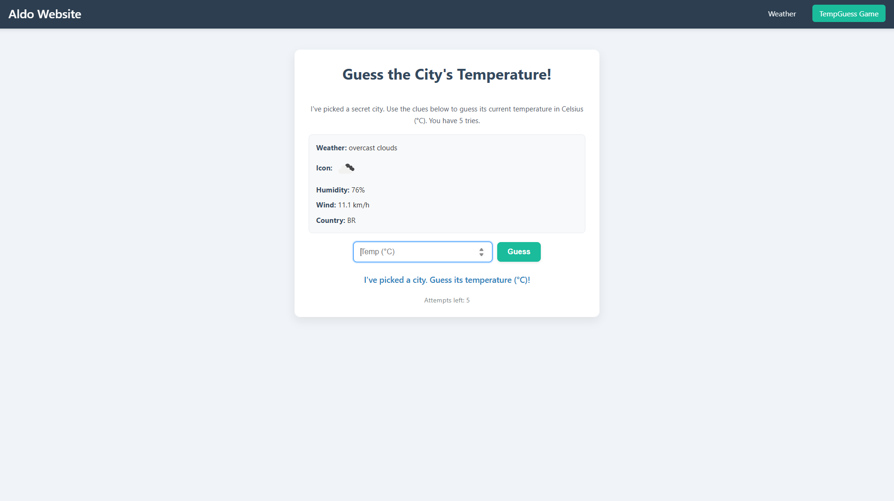

# Pro Weather & Game App

A small vanilla JavaScript web app with two tabs: a current-weather lookup for any city, and "TempGuess", a game where you guess a secret city's temperature from weather clues. Both use the OpenWeatherMap API.

Early bootcamp exercise, built in May 2025. It is a single static page with no build step, framework or tests.

**Live demo:** https://aldonvacriates.github.io/Pro-Weather-Game-App/




## Features

### Weather lookup

- Search any city by name and see its current conditions.
- Shows city and country, temperature in Celsius (plus a Fahrenheit tile), "feels like", description and icon, humidity, wind speed (km/h) and compass direction, min/max temperature, sunrise and sunset in the city's local time, pressure, visibility and cloudiness.
- Specific error messages for an unknown city (404) or a rejected API key (401), and a generic message for other API errors.
- Layout adjusts for narrow screens via media queries at 768px and 600px in `styles.css`.

### TempGuess game

- Picks a random city from a hardcoded list of 20 world cities.
- Shows clues: weather description and icon, humidity, wind speed and country code.
- You get 5 guesses at the temperature in Celsius. Feedback is "Spot on!" for an exact match (to one decimal), "Very close!" within 1 °C, "Getting warmer..." within 3 °C, and "Too high" / "Too low" otherwise.
- When the game ends, the city name and actual temperature are revealed, with a Play Again button.

## Tech stack

- HTML5, CSS3 (Flexbox and CSS Grid)
- Vanilla JavaScript (ES6+, `fetch` with `async`/`await`)
- [OpenWeatherMap Current Weather API](https://openweathermap.org/current)
- Hosted on GitHub Pages

## How it works

All logic lives in `index.js`.

- **One API helper for both features.** `getWeatherData(city)` calls the `/data/2.5/weather` endpoint with `units=metric` and turns HTTP 404 and 401 responses into readable errors. The weather tab and the game both call it.
- **Local sunrise and sunset times.** The API returns UTC timestamps plus the city's `timezone` offset in seconds. `formatTime` adds the offset and reads the result with `getUTCHours` / `getUTCMinutes`, so times show in the city's local time rather than the viewer's.
- **DOM built with `createElement` and `textContent`.** The weather card is assembled node by node instead of from an HTML string, so API text is never parsed as HTML.
- **Lazy game start.** The game only fetches a city the first time you open its tab (`setActiveSection` calls `startTempGuessGame`), so the weather tab does not spend an API call on it. Game state (target temperature, attempts left) is kept in module-level variables.

## Getting started

Prerequisites: a modern browser and a free OpenWeatherMap API key.

1. Clone the repository:

   ```bash
   git clone https://github.com/Aldonvacriates/Pro-Weather-Game-App.git
   cd Pro-Weather-Game-App
   ```

2. Get your own API key: sign up at [OpenWeatherMap](https://openweathermap.org/appid), then copy a key from the [API keys page](https://home.openweathermap.org/api_keys).

3. Open `index.js` and replace the value of `apiKey` near the top with your key:

   ```javascript
   const apiKey = "YOUR_OPENWEATHERMAP_API_KEY";
   ```

   There is no `.env` file or build step. This is a static page, so the key is sent from the browser and is visible to anyone using it. Only use a free-tier key here.

4. Open `index.html` in your browser, or serve the folder with any static file server.

There are no automated tests.

## Project structure

```
.
├── index.html     # Page markup: navbar, weather section, game section
├── index.js       # API calls, weather card rendering, game logic
├── styles.css     # Layout, cards and responsive breakpoints
└── images/        # Screenshots used in this README
```

## What I'd improve next

- Move the API call behind a small serverless proxy so the key is not shipped to the browser.
- Escape the city name with `encodeURIComponent` before building the request URL.
- Split `index.js` into modules (API, weather view, game) and replace the global game state with a small state object.
- Add unit tests for the pure helpers (`formatTime`, `getWindDirection`) and the guess-feedback logic.

## Credits

Weather data and icons from [OpenWeatherMap](https://openweathermap.org/).
